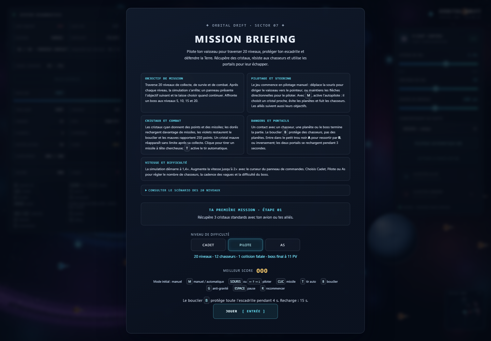

# 🚀 Orbital Drift 

[Code source](https://github.com/aymenabouzya/SteeringBehavioursM2IA2_Casa_Aymen_ABOUZYA_G1)

Jeu d’action spatial en p5.js autour des **steering behaviors** de Craig W. Reynolds. Pilote un vaisseau dans une galaxie, récupère des cristaux et combats les chasseurs rouges jusqu’au boss final. La souris permet de diriger le joueur en pilotage manuel ; en mode automatique, son vaisseau poursuit les cristaux, évite les obstacles et fuit les ennemis.

Le projet transforme des comportements de pilotage en une campagne jouable de 20 niveaux : escadrilles autonomes, trois difficultés, missiles à tête chercheuse, bouclier, portails de téléportation et décor spatial généré par le jeu.

## Démonstration

- [Jouer en ligne avec GitHub Pages](https://aymenabouzya.github.io/SteeringBehavioursM2IA2_Casa_Aymen_ABOUZYA_G1/)
- [Code source du projet](https://github.com/aymenabouzya/SteeringBehavioursM2IA2_Casa_Aymen_ABOUZYA_G1)



## Jouer

1. Ouvrir le jeu depuis GitHub Pages, ou lancer `index.html` avec Live Server.
2. Choisir une difficulté dans l’écran de briefing.
3. Cliquer sur **JOUER** ou appuyer sur **Entrée**.
4. Piloter le vaisseau à la souris ou au clavier, récupérer les cristaux et terminer les objectifs de chaque niveau.
5. Tirer sur les chasseurs et les boss en évitant les collisions avec les ennemis et les corps célestes.

### Commandes

| Entrée | Action |
| --- | --- |
| Souris | Diriger le vaisseau en pilotage manuel |
| `←` `↑` `→` `↓` | Piloter au clavier |
| `M` | Basculer entre pilotage manuel et automatique |
| Clic | Tirer un missile sur l’ennemi ou le boss le plus proche |
| `T` | Activer ou couper le tir automatique |
| `B` | Activer le bouclier pendant 4 secondes (recharge de 15 secondes) |
| `G` | Activer ou désactiver l’anti-gravité |
| `Espace` ou `Échap` | Mettre en pause ou reprendre |
| `R` | Recommencer après une défaite ou une victoire |
| `D` | Afficher les indicateurs de débogage |
| `Maj` + clic | Ajouter un astéroïde à la position du curseur |
| `P` / `O` | Ajouter une planète ou un obstacle |

Le panneau **FLIGHT CONTROL** permet aussi de régler la vitesse, le nombre de cristaux, la portée défensive des chasseurs, le comportement de la flotte et le nombre d’avions alliés ou ennemis.

## Exécution locale

Prérequis : Git, un navigateur moderne et Python 3 (ou l’extension Live Server de VS Code).

```bash
git clone https://github.com/aymenabouzya/SteeringBehavioursM2IA2_Casa_Aymen_ABOUZYA_G1.git
cd SteeringBehavioursM2IA2_Casa_Aymen_ABOUZYA_G1
python -m http.server 8000
```

Sous Windows, si la commande `python` n’existe pas, utiliser `py -m http.server 8000`. Sous macOS ou Linux, utiliser `python3 -m http.server 8000` si nécessaire.

Ouvrir ensuite `http://localhost:8000`. Le jeu utilise p5.js fourni dans `libraries/` et peut fonctionner hors ligne une fois le dépôt cloné.

## Principe algorithmique

### Modèle de Reynolds

Les véhicules de la simulation héritent de `Vehicle`. Leur état de locomotion comprend une position, une vitesse et une accélération représentées par des `p5.Vector`.

Un comportement de pilotage calcule une force de steering à partir d’une vitesse désirée et de la vitesse actuelle :

```text
direction = cible - position
vitesseDésirée = direction normalisée × vitesse maximale
steering = vitesseDésirée - vitesse actuelle
steering limitée à maxForce
```

La force est appliquée avec `applyForce()`, puis `update()` intègre l’accélération, la vitesse et la position. Les comportements indiquent comment un véhicule doit s’orienter ; ils ne remplacent pas directement sa locomotion.

### Seek et Arrival

`seek` dirige un véhicule vers une cible en lui donnant une vitesse désirée dans cette direction. `arrive` adapte cette vitesse à la distance : le véhicule ralentit en approchant, ce qui évite les changements de direction brusques. Le pilotage manuel emploie Arrival pour rejoindre la cible de souris ; le joueur peut aussi contrôler son vaisseau avec les flèches.

### Composition des comportements

En mode automatique, le vaisseau du joueur poursuit le cristal vivant le plus proche. Sa trajectoire combine les forces pertinentes au contexte :

- évitement prédictif des obstacles et corps célestes, prioritaire lorsque la trajectoire est menacée ;
- fuite des chasseurs rouges proches ;
- séparation pour limiter les regroupements entre avions ;
- attraction gravitationnelle, ou anti-gravité lorsqu’elle est activée.

Les modes de flotte proposent trois compositions : `MISSION` pour rechercher les cristaux, `ESSAIM` pour combiner séparation, alignement et cohésion, et `PATROUILLE` pour suivre un circuit. Les chasseurs rouges gardent les cristaux et interceptent les avions blancs qui s’en approchent. Les missiles poursuivent une position prédite de leur cible.

### Campagne, cristaux et combats

- La campagne comporte 20 objectifs : collecte de cristaux, survie, élimination de chasseurs, collecte de cristaux bonus et combats de boss.
- Les boss apparaissent aux niveaux 5, 10, 15 et 20 ; leur nombre de points de vie augmente au fil de la campagne.
- Un cristal standard rapporte 25 points et une munition. Les cristaux bonus dorés et violets rapportent 75 points ; les dorés rechargent les missiles et les violets restaurent le bouclier. Les cristaux mauves rapportent 250 points.
- Les chasseurs et les boss peuvent être attaqués avec des missiles. Chaque missile qui atteint un boss lui retire un point de vie.
- Les meilleurs scores sont conservés séparément selon la difficulté dans `localStorage`.
- Les trous noirs A et B téléportent le joueur de l’un à l’autre et se rechargent pendant 3 secondes.

Trois difficultés modifient le nombre initial de chasseurs et les vagues de renforts :

| Difficulté | Chasseurs initiaux | Renforts | Points de vie initiaux du boss |
| --- | ---: | --- | ---: |
| Cadet | 7 | Toutes les 35 secondes, jusqu’à 18 chasseurs | 3 |
| Pilote | 12 | Toutes les 25 secondes, jusqu’à 28 chasseurs | 5 |
| As | 16 | Toutes les 20 secondes, jusqu’à 38 chasseurs | 7 |

### Décor procédural

La galaxie, les planètes et le soleil sont dessinés localement avec p5.js, sans images distantes. La texture de fond et les surfaces célestes sont générées puis mises en cache ; quelques étoiles de premier plan scintillent et se déplacent en parallaxe. Les astéroïdes restent stationnaires et peuvent être évités.

## Architecture

| Fichier | Responsabilité |
| --- | --- |
| `index.html` | Structure de la page, interface, chargement des scripts et des bibliothèques |
| `style.css` | Mise en page, panneaux, briefing et affichage du jeu |
| `sketch.js` | Boucle p5.js, état de la partie, entrées, rendu et coordination des entités |
| `vehicle.js` | Base des véhicules, locomotion et comportements de pilotage communs |
| `ship.js` | Vaisseaux, pilotage manuel et composition du steering automatique |
| `hunter.js` | Chasseurs rouges, défense des cristaux et interception |
| `boss.js` | Boss de campagne et points de vie |
| `missile.js` | Missiles et poursuite des cibles |
| `target.js` | Cristaux et comportements associés |
| `obstacle.js` | Corps célestes stationnaires et obstacles |
| `asteroid.js` | Astéroïdes facettés |
| `blackHole.js` | Portails appariés et téléportation |
| `flocking.js` | Séparation, alignement et cohésion de l’essaim |
| `pathFollowing.js` | Projection et suivi du chemin de patrouille |
| `gameRules.js` | Difficultés, objectifs, progression et règles de collision |
| `hud.js` | Mise à jour des diagnostics et de l’interface |
| `tests/game.test.mjs` | Tests des comportements, règles, commandes et interface |
| `tests/step-1.test.mjs` | Tests unitaires des comportements de base |

## Tests

Prérequis : Node.js.

```bash
node --test tests/*.test.mjs
```

La suite vérifie notamment :

- les comportements de steering et la limitation des forces ;
- l’évitement prédictif, le pilotage manuel et automatique ;
- le flocking, le suivi de chemin et les comportements des chasseurs ;
- les règles des 20 niveaux, des difficultés, des boss et des cristaux ;
- la pause, les commandes, la progression et le redémarrage ;
- le chargement des modules et la cohérence de l’interface.

## Technologies

- JavaScript sans framework
- p5.js
- HTML et CSS
- Node.js Test Runner

## Limites

- Le meilleur score et la difficulté sélectionnée sont enregistrés localement dans le navigateur.
- Une collision du joueur avec un chasseur ou un corps céleste peut terminer la partie ; le bouclier protège des chasseurs, mais pas des planètes ni des boss.
- Le jeu est une démonstration pédagogique de steering behaviors, pas une simulation physique réaliste.

## Référence

Craig W. Reynolds, *Steering Behaviors for Autonomous Characters*, GDC 1999.
